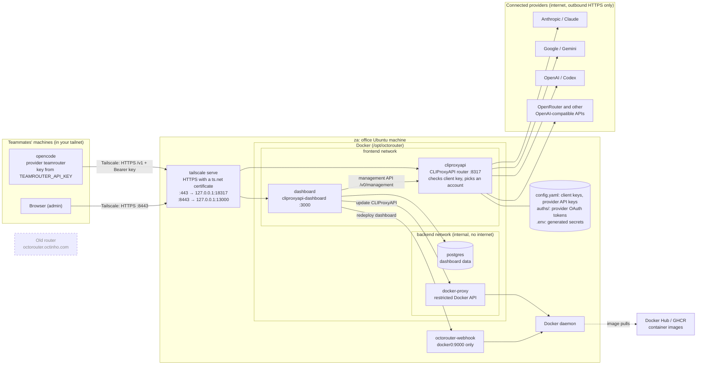
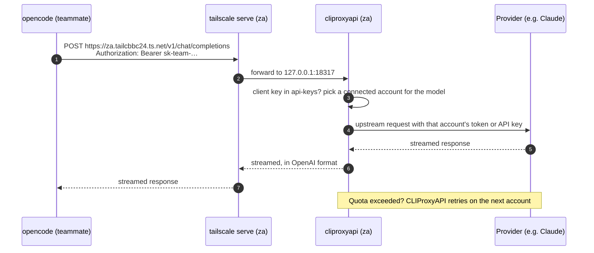

# Team router (Octorouter clone on `za`)

A team LLM router: one OpenAI-compatible API in front of shared Claude, Gemini, Codex and other provider
accounts, with a web dashboard to manage them. It runs on the office machine **`za`** (Ubuntu, 2× RTX
3090) and the team reaches it over **Tailscale**. Nothing is exposed to the office network or the
internet.

| | |
|---|---|
| API | `https://za.tailcbbc24.ts.net/v1` |
| Dashboard | `https://za.tailcbbc24.ts.net:8443` |
| Management page | `https://za.tailcbbc24.ts.net/management.html` |
| Runtime files | `/opt/octorouter` on `za` (config, secrets, provider logins) |

`bootstrap.sh` prints the actual addresses; they change if the machine or tailnet is renamed.

**Services** (`services/docker-compose.yml`): CLIProxyAPI (the router), cliproxyapi-dashboard (web UI),
Postgres (dashboard database), and a Docker socket proxy (lets the dashboard update CLIProxyAPI). On the
host, `tailscale serve` provides HTTPS and an `octorouter-webhook` service lets the dashboard redeploy
itself. GPUs are not used: the router only forwards requests.

## How it fits together



- **Only inbound path:** a device in your tailnet calls `za.tailcbbc24.ts.net`. Tailscale ends HTTPS on
  `za` and forwards it to ports that listen on loopback only. Nothing listens on the office network
  or the internet.
- **Only outbound paths:** CLIProxyAPI calling the providers, and Docker pulling images. Postgres and
  the Docker socket proxy sit on an internal network with no internet access.
- **Two kinds of key:** teammates' **client keys** (`api-keys:` in `config.yaml`) only grant access to
  the router. The **provider credentials** (OAuth tokens in `auths/`, API keys in `config.yaml`) never
  leave `za`. CLIProxyAPI attaches them to upstream requests and rotates between accounts
  (round-robin, moving to the next when one hits its quota).
- **The old router** (dashed) has no connection to any of this. The two may use the same providers
  only if you connect the same accounts to both.
- **Not involved:** the local models on `za` (llama-swap and the Agent Console in `agent-console`) are
  separate. The router doesn't use the GPUs.

One request, end to end:



## Origin and isolation

This repo started as a copy of the octorouter.octinho.com deployment in
`barrie-davies/octopws-operational-tools` (`apps/octorouter`), with its git history up to commit
`18b50a6` (2026-09-23). The AWS/EC2 provisioning (SST, Caddy) has been removed; it is in the history if
ever needed.

It is an **independent clone, not a replacement**. Nothing is shared with the old router:

- **Secrets:** `bootstrap.sh` generates new ones (Postgres, JWT, management key, deploy secret, first
  client key). Old client keys and the old management key do not work here.
- **Provider logins:** none are carried over. You connect accounts fresh in this dashboard.
- **Network:** reachable only from devices in your own tailnet. The old server and anyone with old keys
  have no route to it.
- **Clients:** teammates use a separately named provider and key variable (section 2), so no existing
  config is pointed here by accident. The old team repo (`opencode-config`) is not changed.
- **Code:** this repo is private to you.

---

## 1. One-time setup

1. **Tailscale** (already done for `za`): create an account at https://login.tailscale.com and, on the
   admin console's **DNS** page, turn on **MagicDNS** and **HTTPS Certificates**.
2. On `za`:
   ```bash
   git clone https://github.com/barrie-davies/octorouter-config.git ~/octorouter-config
   sudo ~/octorouter-config/bootstrap.sh
   ```
   It installs Docker and Tailscale if missing (and signs the machine in to Tailscale if needed), then
   starts everything. At the end it prints the addresses and the **first client key** (yours). Keep
   that output.
3. **Stop the machine sleeping**, or the router goes down with it:
   ```bash
   sudo systemctl mask sleep.target suspend.target hibernate.target hybrid-sleep.target
   ```
4. **Connect provider accounts** in the dashboard (section 3). Sharing a personal consumer subscription
   across a team may break that plan's terms; API keys or team plans are the safe option.
5. **Check it** from any tailnet device:
   ```bash
   curl -H "Authorization: Bearer <client key>" https://za.tailcbbc24.ts.net/v1/models
   ```

Re-running `bootstrap.sh` is safe: it refreshes files from the repo and keeps `.env`, `config.yaml` and
the stored logins.

---

## 2. Adding a teammate

1. **Tailscale access.** Invite them to your tailnet (admin console → Users → Invite), or share just
   `za` with them (Machines → za → Share). They install Tailscale and sign in. Then, in **Access
   controls**, limit teammates to TCP ports **443 and 8443** on `za`, so they can't reach anything else
   on it (SSH, other services).
2. **Their own API key.** Generate one and add it to the `api-keys:` list, with their name as a comment:
   ```bash
   echo "sk-team-$(openssl rand -hex 24)"
   sudo nano /opt/octorouter/config.yaml
   cd /opt/octorouter && sudo docker compose restart cliproxyapi
   ```
   ```yaml
   api-keys:
     - "sk-team-..."  # admin (first key)
     - "sk-team-..."  # alice
   ```
   To remove someone, delete their line and restart `cliproxyapi`.
3. **Their opencode config.** A provider of its own, alongside anything else they have. Do not point the
   old team's `cliproxyapi` provider or its `OCTOROUTER_API_KEY` at this router. In
   `~/.config/opencode/opencode.json` (or their own overlay config):
   ```json
   "teamrouter": {
     "npm": "@ai-sdk/openai-compatible",
     "name": "Team router (za)",
     "options": {
       "baseURL": "https://za.tailcbbc24.ts.net/v1",
       "apiKey": "{env:TEAMROUTER_API_KEY}"
     }
   }
   ```
   and `export TEAMROUTER_API_KEY="sk-team-..."` in their shell.

Every key draws on the same connected provider accounts; there are no per-person quotas. To limit
spend, set limits at the provider (for example on an API key).

---

## 3. Provider accounts

**Claude (subscription OAuth):** in the dashboard, open the Claude OAuth section and follow the
browser sign-in. The tokens are saved and picked up automatically.

**Gemini (Google OAuth):** needs a one-off container on `za`, run from a terminal on `za` itself (the
sign-in callback goes to `localhost:8085`; from another machine, first `ssh -L 8085:localhost:8085 za`):
```bash
cd /opt/octorouter
sudo docker run --rm -it \
  -p 127.0.0.1:8085:8085 \
  -v /opt/octorouter/auths:/root/.cli-proxy-api \
  -v /opt/octorouter/config.yaml:/CLIProxyAPI/config.yaml:ro \
  eceasy/cli-proxy-api-plus:latest \
  ./CLIProxyAPIPlus -login -no-browser
```
Open the Google URL it prints, sign in, choose **2** (Google One mode), then
`sudo docker compose restart cliproxyapi`. Don't use `docker exec` on the running container for this:
the login tries to bind port 8317, which is already in use.

**API keys** (Gemini AI Studio, OpenAI/Codex, Anthropic, OpenRouter, ...): paste them in the dashboard,
or uncomment the matching block at the end of `/opt/octorouter/config.yaml` and restart `cliproxyapi`.

---

## 4. Running it

```bash
cd /opt/octorouter
sudo docker compose ps
sudo docker compose logs -f cliproxyapi
sudo systemctl status octorouter-webhook
tailscale serve status
```

- **Management key** (admin login for the dashboard and `/management.html`):
  `sudo sed -n 's/^MANAGEMENT_API_KEY=//p' /opt/octorouter/.env`
- **Back up** `/opt/octorouter/.env`, `config.yaml` and `auths/`. They hold every secret and provider
  login.
- **Containers not starting:** `sudo docker compose ps`; for one in a restart loop, check its logs,
  usually for an error in `config.yaml`.
- **HTTPS not working:** `tailscale serve status`, and check HTTPS Certificates is on in the Tailscale
  admin console.

### Updating CLIProxyAPI

From the dashboard (preferred): when it shows an *Update Available* banner, click the specific version
button in the *Available Versions* row. Avoid **Update to Latest**: it unpins the tag and the dashboard
then shows "latest" forever. Afterwards, **bump the image tag in `services/docker-compose.yml`**, commit,
pull on `za`, and re-run `bootstrap.sh`.

> **Drift warning:** dashboard updates change only the running container, not the compose file. If you
> skip the bump, a reboot or `docker compose up -d` recreates the container at the older tag in compose,
> silently downgrading it. The `cliproxyapi` image must stay pinned to a versioned tag.

> **Known quirk:** the *Update Available* banner shows even when current and latest match (it compares
> different kinds of image ID). Ignore it unless *Latest Version* is genuinely newer.

Manual update: `cd /opt/octorouter && sudo docker compose pull && sudo docker compose up -d`.

### Dashboard deploy webhook

The dashboard can redeploy itself from its admin panel through
[adnanh/webhook](https://github.com/adnanh/webhook) on the host (systemd: `octorouter-webhook`),
listening on port 9000 on the Docker bridge only. The deploy secret in `/opt/octorouter/.env` is
checked as the `X-Deploy-Token` header on every call. Hooks, called by the dashboard container only:
`deploy-dashboard`, `deploy-dashboard-nocache` (same thing; the image is prebuilt), `deploy-status`,
`deploy-log`, all at `http://host.docker.internal:9000/hooks/<id>`.

```bash
sudo journalctl -u octorouter-webhook -f
sudo tail -f /var/log/octorouter/dashboard-deploy.log
```

---

## 5. Layout

```
bootstrap.sh                 sets up or refreshes everything on za
services/
  docker-compose.yml         the stack
  config.example.yaml        CLIProxyAPI config template (bootstrap fills in the first key)
  webhook/                   deploy webhook: hooks, script, systemd unit

/opt/octorouter/ on za       (created by bootstrap.sh; never commit any of it)
  .env                       generated secrets and the Tailscale URLs
  config.yaml                CLIProxyAPI config, including team API keys
  docker-compose.yml
  auths/                     provider OAuth tokens
  logs/
  webhook/
```

## 6. Removing it

```bash
tailscale serve reset
cd /opt/octorouter && sudo docker compose down        # add -v to also delete the database
sudo systemctl disable --now octorouter-webhook
sudo rm /etc/systemd/system/octorouter-webhook.service
```
Then delete `/opt/octorouter` if you no longer need the logins and keys in it.
